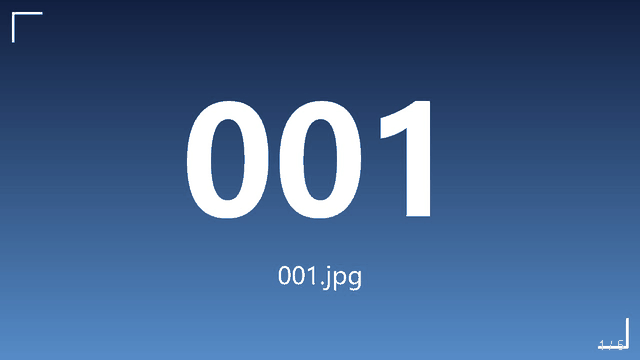

# 本地图片轮播（双击 index.html 就能播）

一个纯静态的全屏图片轮播页面：不需要服务器、不需要联网、不读 json。
把 `web/index.html` 和你的图片放进同一个文件夹，双击就能播。

```
photoframe/
├── web/                    ← 用到的全部文件
│   ├── index.html          （轮播页面，单文件，无外部依赖）
│   ├── list.js             （可选清单，不用就留空或删掉）
│   └── 001.jpg … 005.jpg   （演示图，可删掉换成自己的照片）
├── media/
│   └── preview.gif         （轮播动图，640×360）
├── preview.png             （静帧截图，也可用作仓库社交预览图）
├── LICENSE                 （MIT）
├── .gitignore
└── README.md
```



动图只演示切换节奏：640×360，五张图一轮约 7 秒；实际页面是全屏播放，图片按原始比例居中，
四周用同图模糊版补底。

---

## 一、怎么用

把 `web/index.html` 和图片放进同一个文件夹，双击 `index.html` 全屏播放。

**图片命名**：从 `001.jpg` 起连续编号（`001.jpg`、`002.jpg` …）。页面自动识别命名格式，
下面几种都能直接用：

| 实际文件名 | 是否支持 |
|---|---|
| `001.jpg` … `099.jpg` | ✅ 优先尝试 |
| `1.jpg` … `99.jpg` | ✅ 自动识别 |
| `01.jpg` … `99.jpg` | ✅ 自动识别 |
| `001.png` / `.jpeg` / `.webp` | ✅ 自动识别 |
| 任意文件名（如 `IMG_20240101.jpg`） | ⚠️ 需要同名 `list.js`，见下 |

**任意文件名**：把 `web/list.js` 一起拷进去，按里面的注释写清单（是 `.js` 不是 `.json`）：

```js
window.PHOTOS = ["IMG_0012.jpg", "IMG_0013.jpg", "照片/A.jpg"];
```

有清单就按清单播；没有清单（文件不存在或清单为空）就按编号自动探测，
控制台会留一条 `list.js` 的 404，不影响播放。

**地址栏参数**：

| 参数 | 作用 | 示例 |
|---|---|---|
| `interval` | 每张停留毫秒数，默认 3000 | `index.html?interval=5000` |
| `blur` | `0` 关闭模糊底衬（老设备省性能） | `index.html?blur=0` |

**交互**：轻触/点击画面暂停或继续，空格键同样切换；切到后台或锁屏时自动停表。

---

## 二、页面是怎么找到图片的

1. 双击 `index.html`，浏览器以 `file:///.../index.html` 打开它；
2. 页面里的图片路径是相对路径，按 **HTML 文件所在目录** 解析成 `file:///.../001.jpg`，
   浏览器直接去本地磁盘读文件——不联网、不需要服务器；
3. 换图就是换 `` 的地址，由 `setInterval` 定时驱动。

**探测顺序**：先试 `list.js` 清单；没有清单时，用 3 位/2 位/1 位补零 × `.jpg/.jpeg/.png/.webp`
共 12 种命名组合并行试第一张（`new Image()`），哪个命中就锁定哪套命名；随后每批 16 张并行往下探测，
遇到缺号即停（`CONFIG.tolerance` 可放宽允许的连续缺号数）。

**清单必须写成 `.js`**：`file://` 下页面的源是 `null`，`fetch`/`XMLHttpRequest` 读同目录的 `.json`
会被同源策略拦掉，页面会白屏；`<script src="list.js">` 不受这条限制，所以清单走 js。

**图片适配**：图片以 `contain` 居中显示（完整不变形，长边贴边），四周用同一张图的模糊放大版铺满，
所以竖图横屏也不会出现死黑边。两张图层交替做透明度过渡，切换不闪。

---

## 三、在安卓上怎么播

`file://` 在安卓上能用，但限制比 Windows 多，按省事程度排：

1. **Firefox for Android**：拷整个文件夹到手机，地址栏输入
   `file:///sdcard/相框/index.html`。Chrome 移动版基本不给开 `file://`，Firefox 可以。
2. **本地 HTTP 服务（最稳）**：Termux 里进到该目录执行 `python -m http.server 8080`，
   手机浏览器访问 `http://127.0.0.1:8080`。http 环境下 `list.js` 和图片都正常，
   也不受 `file://` 的各种限制。
3. 投屏/电视盒子：同样用上面两种方式，横屏效果最好。

---

## 四、已知限制

- **不要用 `fetch`/`XHR` 读本地 json**：`file://` 下会被同源策略拦掉，清单请用 `list.js` 或内联。
- **图片要连续**：探测到缺号就停，中间断号会导致后面的图播不到（`CONFIG.tolerance` 可放宽）。
- **模糊底衬吃 GPU**：2018 年前的老设备上切换可能掉帧，用 `?blur=0` 或把 `CONFIG.blur` 改 `false`。
- **图片多时首屏慢**：每批探测 16 张，1000 张图会多花几百毫秒。
- **验证程度**：Windows 上已用无头 Edge 截图核对布局与切换（清晰单张、交叉淡入中途、空目录提示、
  竖屏留边 + 模糊底衬），并用假 DOM 单测覆盖探测/定时/暂停逻辑；安卓真机未实测。

---

## 五、许可证

MIT，见 [LICENSE](LICENSE)。演示图 `001.jpg`–`005.jpg` 与 `preview.png` 是程序生成的渐变示意图，
不含第三方素材。

